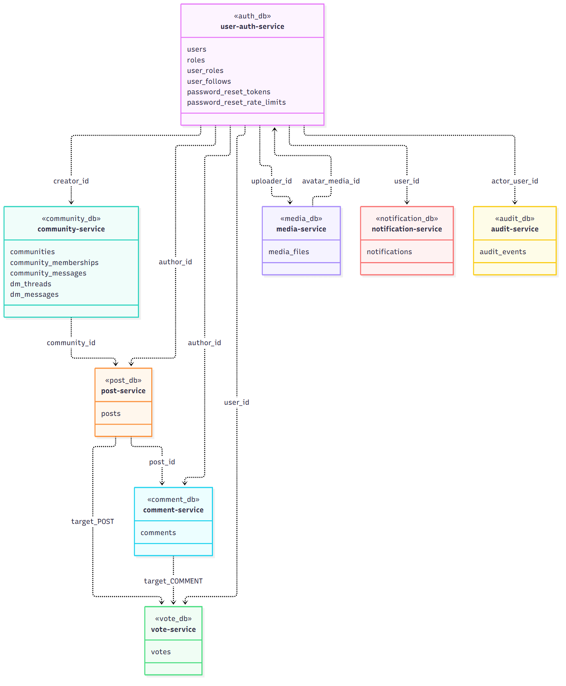
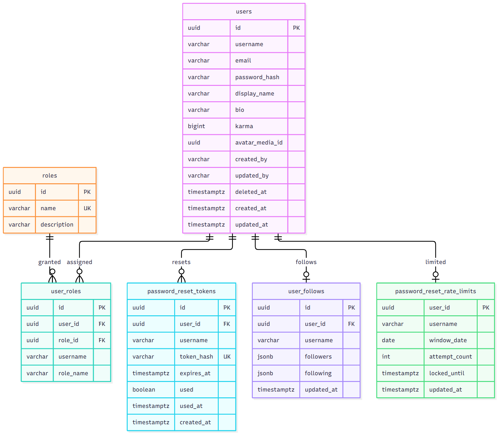
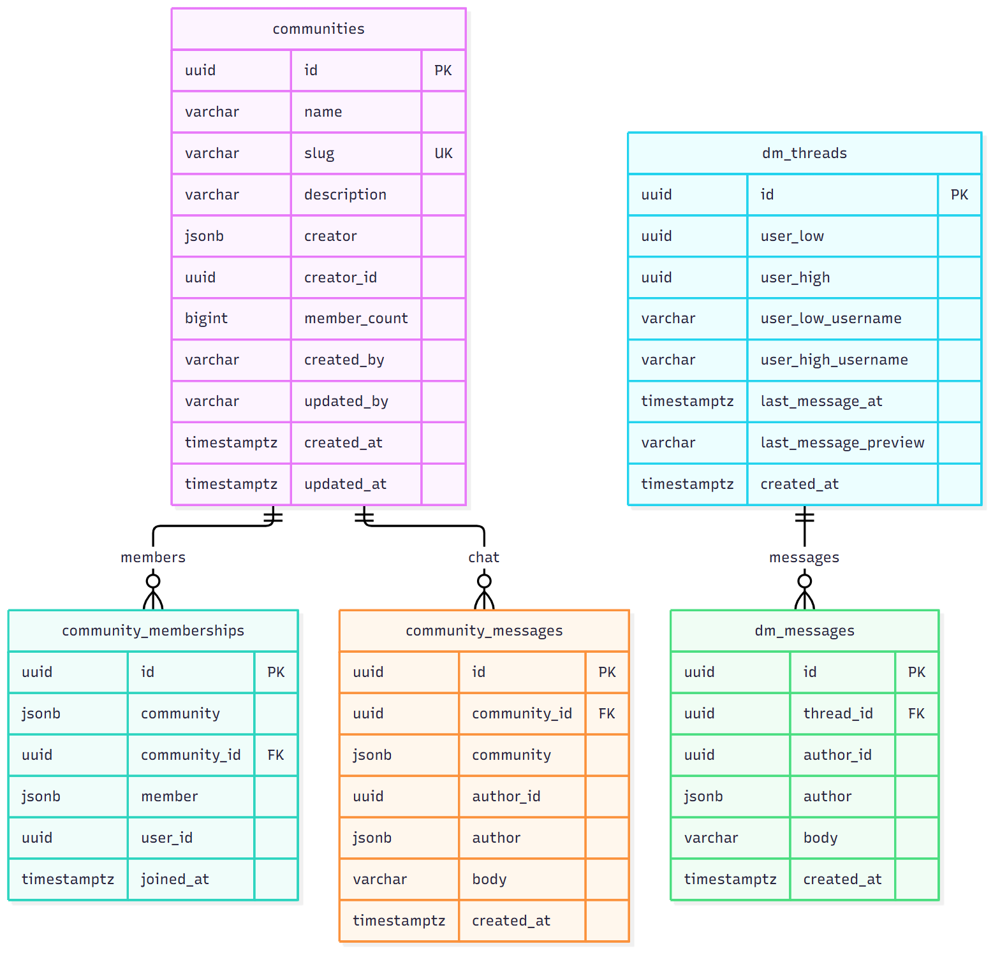
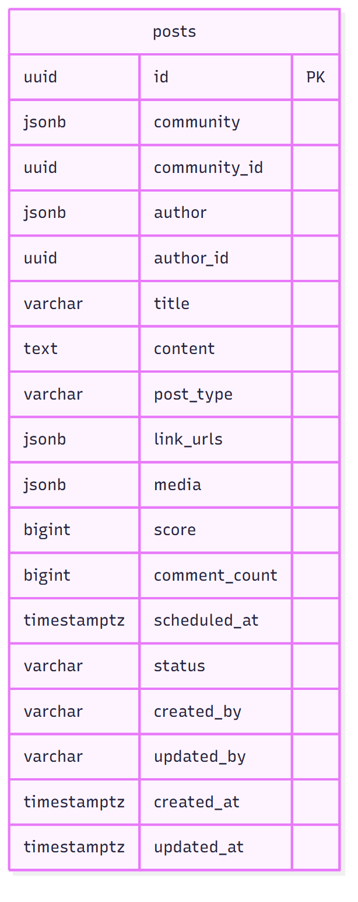
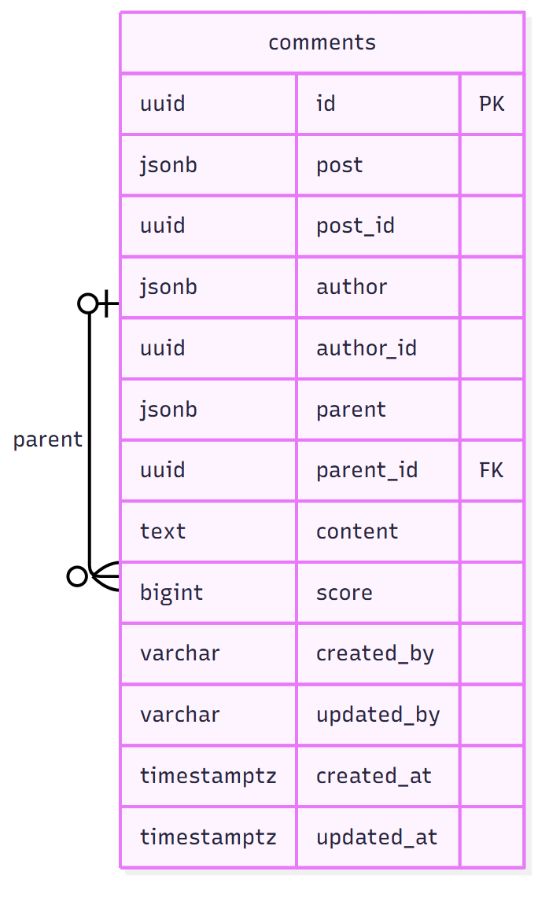
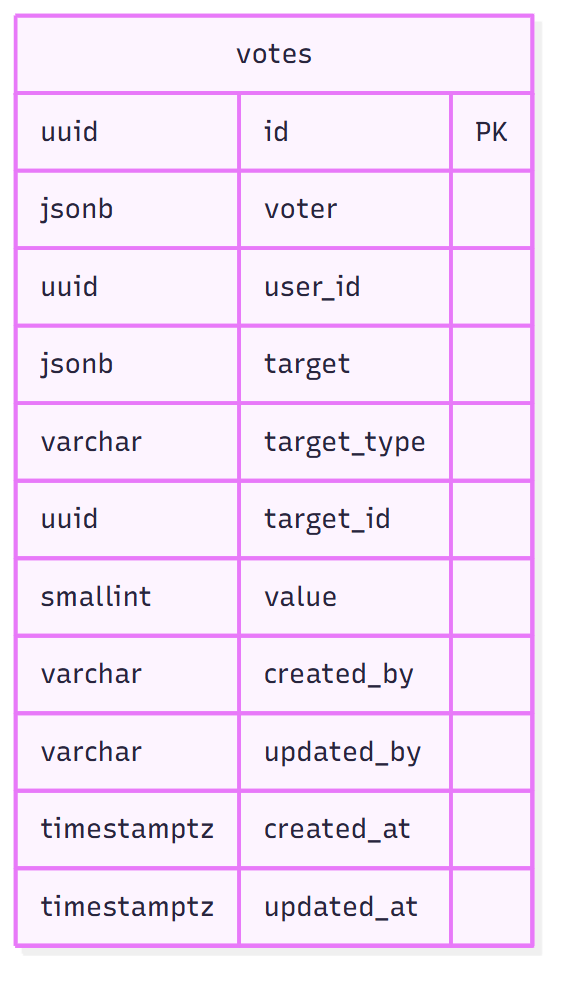
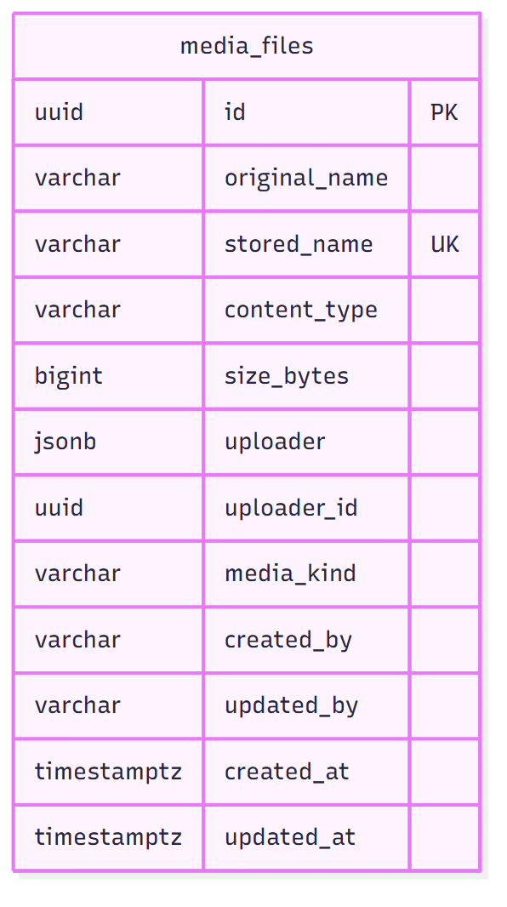
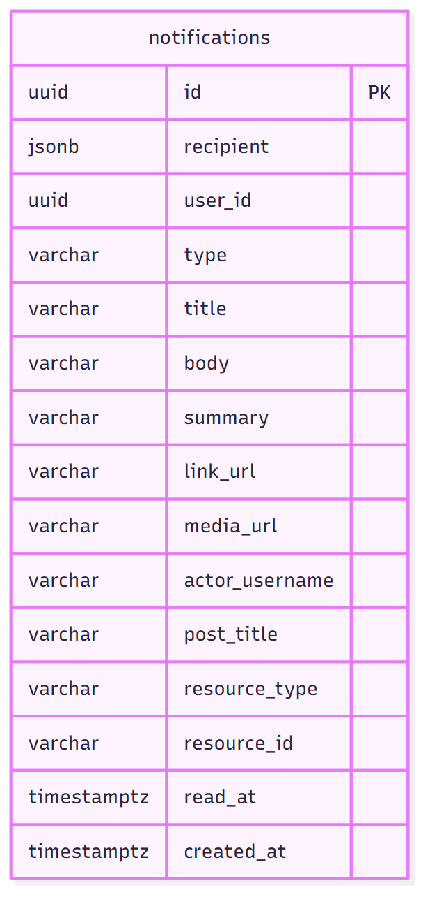
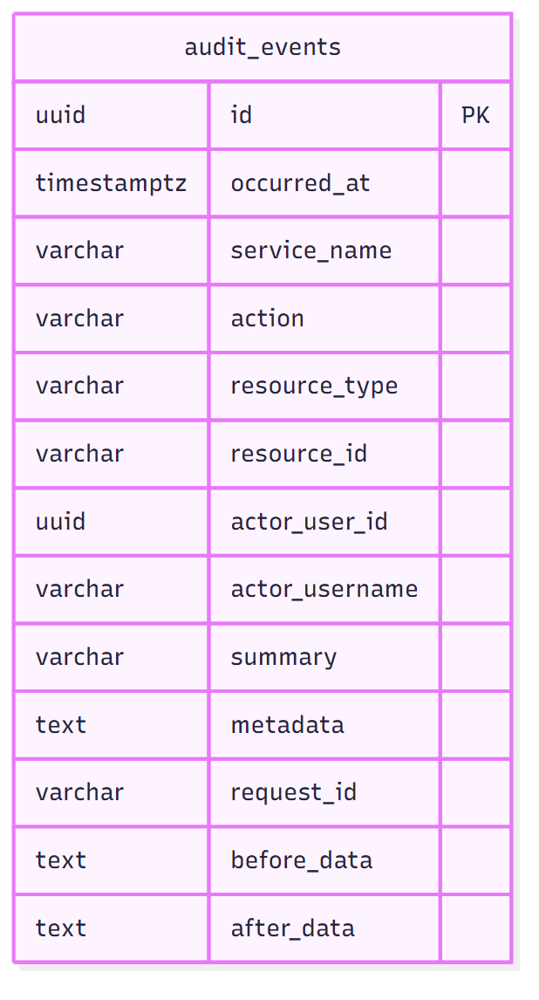

# Database diagrams

These are the schema pictures. Open a PNG in `docs/diagrams/` to view it full size, or use Markdown preview on this file (`Ctrl+Shift+V`).

Threadly keeps **one Postgres database per service**. A line inside a database diagram is a real foreign key. A dotted line on the overview is only a UUID stored by the application. Postgres does not enforce those cross-database links.

## How the databases connect

Each box is one service. The name in « » is its database, and the list under it is the tables in that database. Dotted arrows are UUID references between services, not foreign keys.

| Stored in | Column | Points at |
|---|---|---|
| `auth_db.users` | `avatar_media_id` | `media_db.media_files.id` |
| `community_db.communities` | `creator_id` | `auth_db.users.id` |
| `community_db.community_memberships` | `user_id` | `auth_db.users.id` |
| `community_db.community_messages` | `author_id` | `auth_db.users.id` |
| `community_db.dm_threads` | `user_low`, `user_high` | `auth_db.users.id` |
| `community_db.dm_messages` | `author_id` | `auth_db.users.id` |
| `post_db.posts` | `author_id` | `auth_db.users.id` |
| `post_db.posts` | `community_id` | `community_db.communities.id` |
| `post_db.posts` | `media` (JSON) | `media_db.media_files.id` |
| `comment_db.comments` | `post_id` | `post_db.posts.id` |
| `comment_db.comments` | `author_id` | `auth_db.users.id` |
| `vote_db.votes` | `user_id` | `auth_db.users.id` |
| `vote_db.votes` | `target_id` + `target_type` | a post or a comment |
| `media_db.media_files` | `uploader_id` | `auth_db.users.id` |
| `notification_db.notifications` | `user_id` | `auth_db.users.id` |
| `audit_db.audit_events` | `actor_user_id` | `auth_db.users.id` |

JSON columns such as `author`, `community`, and `voter` are snapshots copied at write time, so a service can show a name without calling another service.

## auth_db

`user-auth-service`. Users, roles, follows, and password reset.

`user_roles` is unique on `(user_id, role_id)`. `user_follows` stores one row per user. `followers` and `following` are JSON arrays of `{id, username}`.

## community_db

`community-service`. Memberships, community chat, and direct messages.

`community_memberships` is unique on `(community_id, user_id)`. `dm_threads` is unique on `(user_low, user_high)` and requires `user_low < user_high`, so each pair of users has one thread. User ids in this database are not foreign keys.

## post_db

`post-service`. One table. `community_id` and `author_id` point at other databases.

`status` is `PUBLISHED` or `SCHEDULED`.

## comment_db

`comment-service`. Replies point at a parent row in the same table. `post_id` and `author_id` point at other databases.

Deleting a parent comment cascades to its replies.

## vote_db

`vote-service`. One row per user and target. `target_type` is `POST` or `COMMENT`. `value` is `1` or `-1`.

Unique on `(user_id, target_type, target_id)`.

## media_db

`media-service`. File bytes live on a volume. This table stores metadata.

## notification_db

`notification-service`.

## audit_db

`audit-service`. Append-style event log for admin search.

