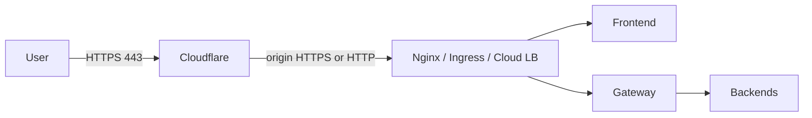

# Edge protection & TLS

Run this **in front of** Compose or Kubernetes so users only ever see HTTPS.

## Recommended layout



| Layer | What to use | Why |
|---|---|---|
| **CDN + WAF + DDoS** | [Cloudflare](https://www.cloudflare.com/) (free tier is enough to start) | Absorbs floods, TLS at the edge, bot filtering |
| **Reverse proxy** | Nginx, Caddy, or K8s Ingress | Terminates TLS on your VM / cluster; routes to `:3000` + `:8080` |
| **App** | Prod-like Compose or K8s | Only frontend + gateway published (see [security.md](./security.md)) |

## Cloudflare (practical first step)

1. Point your domain DNS to Cloudflare.
2. Proxied (orange cloud) A/AAAA records for `app` and `api` (or one host with path routing).
3. SSL/TLS mode: **Full** (or Full strict with a real origin cert).
4. Enable **Always Use HTTPS** and **HSTS** (once you confirm HTTPS works).
5. Set `CORS_ALLOWED_ORIGINS` and `NEXT_PUBLIC_API_URL` / `FRONTEND_BASE_URL` to your HTTPS origins.

## Nginx + Let’s Encrypt (single VM)

Typical flow on a VPS:

1. Install Nginx + Certbot.
2. Proxy `https://yourdomain` → `http://127.0.0.1:3000`.
3. Proxy `https://api.yourdomain` → `http://127.0.0.1:8080` (WebSocket upgrade headers for `/ws`).
4. Do **not** open `8081–8088`, Postgres, Redis, MinIO, Grafana on the public firewall.

Example WebSocket headers (gateway chat):

```nginx
proxy_http_version 1.1;
proxy_set_header Upgrade $http_upgrade;
proxy_set_header Connection "upgrade";
proxy_set_header Host $host;
proxy_set_header X-Forwarded-For $proxy_add_x_forwarded_for;
proxy_set_header X-Forwarded-Proto $scheme;
```

## Kubernetes

Use Ingress-nginx + cert-manager (Let’s Encrypt) or terminate TLS at Cloudflare and keep Ingress HTTP inside the VPC. Manifests: [kubernetes.md](./kubernetes.md).

## Checklist tie-in

Mark items in [production-readiness-checklist.md](./production-readiness-checklist.md) section 2 after you:

- Force HTTPS
- Lock firewall to 80/443
- Confirm chat/DM WebSockets over WSS
- Turn on HSTS
