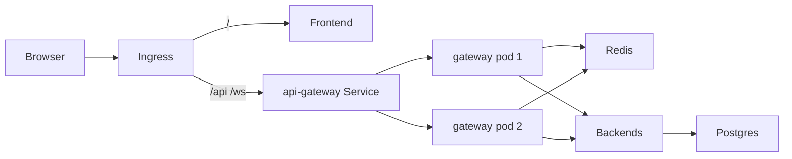

# Kubernetes + load balancing (local)

This folder [`infra/k8s/`](../infra/k8s/) is a **local / resume-ready** Kubernetes layout. You do **not** need AWS/GCP to learn or demo it.

## What each piece does

| Piece | Role |
|---|---|
| **Pod / Deployment** | Runs your containers; gateway has **2 replicas** |
| **Service (ClusterIP)** | Stable DNS name inside the cluster; **load-balances** across pod IPs |
| **Ingress (nginx)** | Cluster edge reverse proxy / load balancer for HTTP(S) from your machine |
| **ConfigMap / Secret** | Non-secret config vs passwords/JWT |
| **Redis** | Shared rate limits, JWT blacklist, and domain caches |
| **Postgres** | Same database-per-service model as Compose |



## Prerequisites

1. [Docker Desktop](https://www.docker.com/products/docker-desktop/) with Kubernetes **or** [Kind](https://kind.sigs.k8s.io/) + `kubectl`
2. [ingress-nginx](https://kubernetes.github.io/ingress-nginx/deploy/) installed in the cluster
3. Images built and loaded into the cluster (Kind does not see your local Docker images until you `kind load`)

## Build & load images (Kind example)

```bash
# From repo root — build each service image tagged for K8s
docker compose build

# Retag Compose image names to threadly/*:local (adjust if your Compose names differ)
for s in user-auth-service community-service post-service comment-service vote-service media-service audit-service notification-service api-gateway frontend; do
  docker tag blog-application-$s threadly/$s:local 2>/dev/null || docker tag threadly-$s threadly/$s:local 2>/dev/null || true
done

kind load docker-image threadly/api-gateway:local
# …repeat kind load for each threadly/*:local image
```

On Docker Desktop Kubernetes, local images with `imagePullPolicy: IfNotPresent` are usually enough after `docker build -t threadly/<service>:local …`.

## Apply manifests

```bash
# Edit secrets first (copy example → real values, do not commit secrets)
cp infra/k8s/secret.example.yaml infra/k8s/secret.yaml
# edit secret.yaml

kubectl apply -f infra/k8s/namespace.yaml
kubectl apply -f infra/k8s/secret.yaml   # or secret.example.yaml for local-only demos
kubectl apply -k infra/k8s/
```

If you applied `secret.example.yaml` via kustomization, replace values before any public use.

Add to hosts file (Windows `C:\Windows\System32\drivers\etc\hosts`):

```
127.0.0.1 threadly.local
```

Frontend build arg / env must point the browser at the gateway through Ingress, e.g. `NEXT_PUBLIC_API_URL=http://threadly.local` (paths `/api/...` already match gateway routes).

## Verify load balancing

```bash
kubectl -n threadly get pods -l app=api-gateway
kubectl -n threadly get svc api-gateway
kubectl -n threadly get ingress
curl http://threadly.local/actuator/health
```

You should see **2** gateway pods. The Service spreads connections across them; Redis keeps rate limits consistent.

## What you provide later (cloud)

| Local (now) | Cloud (later) |
|---|---|
| Kind / Docker Desktop | EKS / GKE / AKS |
| Ingress-nginx on localhost | Cloud Load Balancer + Ingress |
| `secret.example.yaml` | AWS Secrets Manager / sealed-secrets |
| Postgres in-cluster | Managed Postgres (RDS etc.) |

## Related

- [redis.md](./redis.md) — why Redis is required with multiple gateways
- [deploy.md](./deploy.md) — Compose still fine for a single VM
- [production-readiness-checklist.md](./production-readiness-checklist.md)
